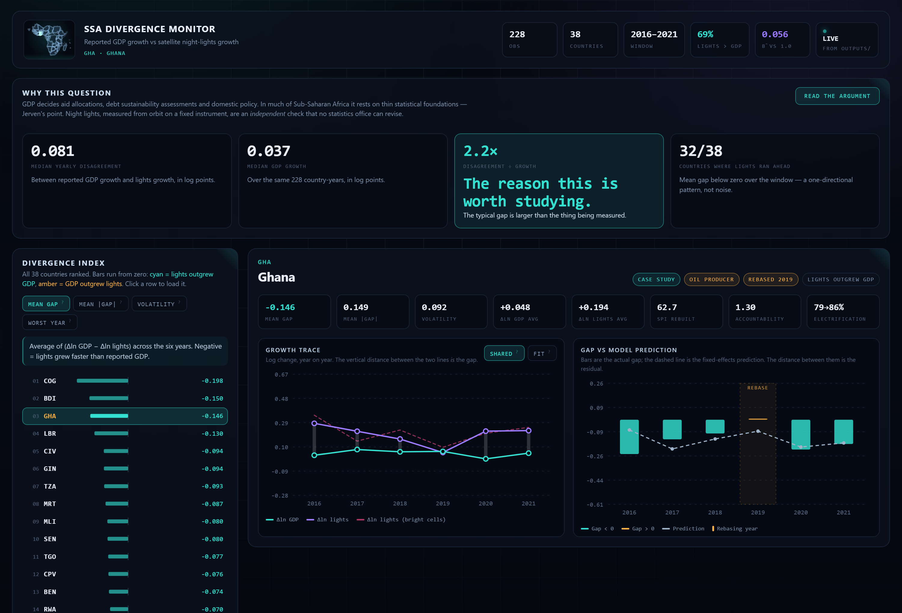
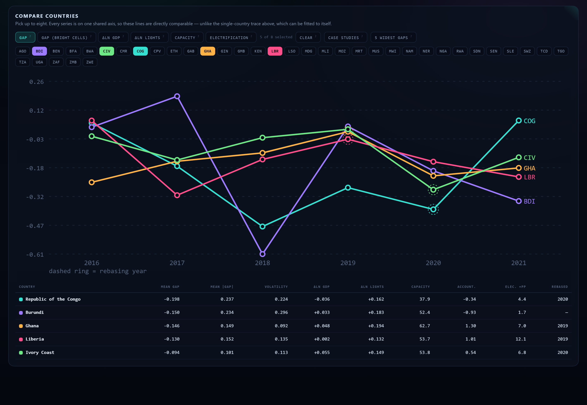
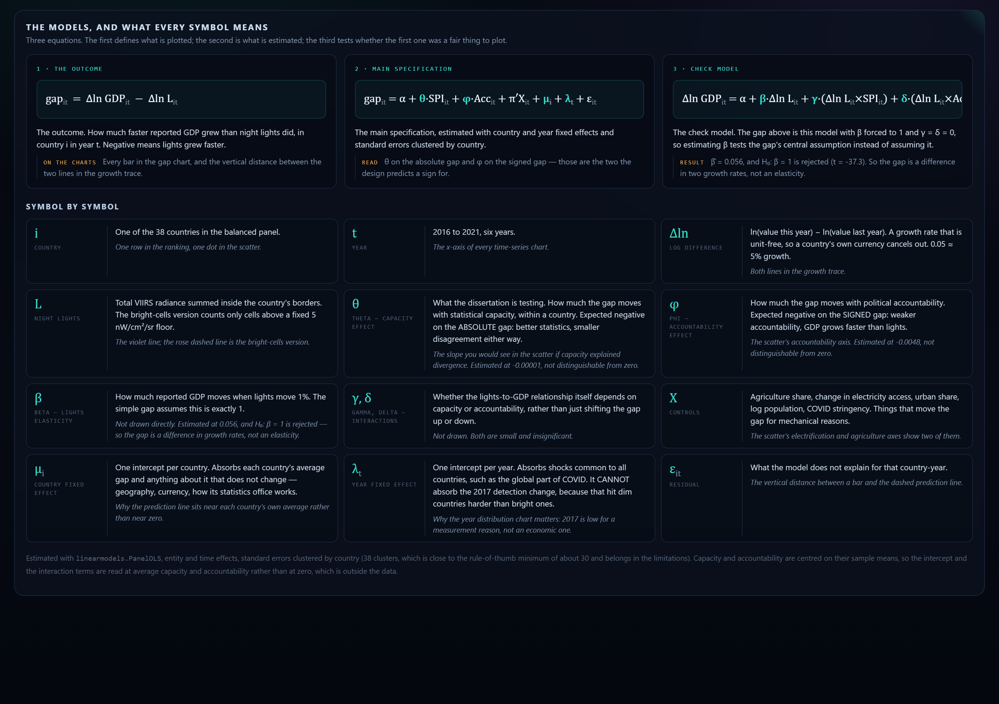

<div align="center">

# SSA Divergence Monitor

**Where official GDP growth and satellite night-lights growth disagree, and why.**

A reproducible panel-econometrics pipeline over 38 Sub-Saharan African
countries, from raw satellite rasters to fixed-effects estimates — with every
step checked against the data rather than assumed.

[](https://www.python.org/)
[](https://pandas.pydata.org/)
[](https://bashtage.github.io/linearmodels/)
[](https://geopandas.org/)
[](https://eogdata.mines.edu/products/vnl/)
[](LICENSE)

### [▶ Download the interactive dashboard](outputs/dashboard.html)

<sub>One self-contained HTML file, 600 KB — open it straight from disk. No
server, no install, no internet, and ten processed datasets travel inside it.
<br>(GitHub shows the source for <code>.html</code>; use the download button,
or run <code>python -m src.dashboard --open</code>.)</sub>

</div>



<div align="center">
<sub>The dashboard: 38 countries ranked by divergence, a per-country growth trace
where the gap <i>is</i> the vertical distance between the lines, and the
fixed-effects prediction against the actual gap with rebasing years flagged.</sub>
</div>

---

## The question

GDP decides aid allocations, debt sustainability assessments and domestic
policy. In much of Sub-Saharan Africa it rests on thin statistical foundations.
Night lights, measured from orbit on a fixed instrument, are an **independent**
check that no statistics office can revise.

So: **where the two disagree, what explains it?** Statistical capacity?
Political accountability? Or something about the measurement itself?

| | |
|---|---|
| **The outcome** | `gap = Δln GDP − Δln lights`, per country-year. Negative means lights grew faster than the official figures. |
| **The panel** | 38 countries × 6 years (2016–2021) = **228 observations**, balanced. Ghana and Kenya as case studies. |
| **The method** | Country and year fixed effects, standard errors clustered by country, plus pooled OLS / random effects / first differences and 11 robustness checks. |

Built while learning Python, panel econometrics and geospatial data
processing, for a BSc dissertation in International Development with
Economics.

## What the data says

**The two series disagree, consistently and in one direction.** Lights outgrew
reported GDP in 69% of country-years and in 32 of 38 countries. The median
yearly disagreement is **0.081 log points against median GDP growth of
0.037** — the typical gap is **2.2× the size of the thing being measured**.

**But the obvious explanations fail.** Neither statistical capacity nor
political accountability moves the gap once country and year effects are taken
out:

| Outcome | Coefficient | Estimate | SE | p |
| --- | --- | --- | --- | --- |
| `abs_gap` | statistical capacity (rebuilt SPI) | −0.0000109 | 0.0018 | 0.995 |
| `gap` | political accountability (V-Dem) | −0.0048 | 0.0332 | 0.886 |

Both stay null across all 11 robustness checks — the smallest p-value on
either term is 0.136.

**And the gap's own premise fails.** The gap assumes GDP and lights move
one-for-one. Estimating that elasticity instead of assuming it gives
**β̂ = 0.056** against H₀: β = 1 — rejected at t = −37.3. The gap is a
difference between two growth rates, not a structural elasticity, and the
write-up has to say so.

**The nulls are bounds, not absences.** This design could only have detected a
capacity effect larger than 0.32 of a within-country standard deviation, and
an accountability effect larger than 0.11. Reporting "no relationship" would
overclaim, so the dashboard and the docs report the detectable range instead.

→ Full results, with the three night-lights findings behind them, in
[`docs/findings.md`](docs/findings.md).

## The dashboard

<table>
<tr>
<td width="50%"><br>
<sub><b>Compare countries</b> — up to eight on one shared axis, across six
metrics, with rebasing years ringed and a summary table underneath. The shared
axis is deliberate: the single-country view can be fitted to itself, which makes
two countries look alike when they are not.</sub></td>
<td width="50%"><br>
<sub><b>The models, symbol by symbol</b> — all three equations with every symbol
explained three ways: what it is, what it means in this data, and where it shows
up on the charts. θ, φ and β show their estimated values, read from the results
tables.</sub></td>
</tr>
</table>

Generated by `python -m src.dashboard`. **Python does every calculation; the
page only draws** — nothing is computed in JavaScript that could disagree with
the pipeline, and no result is hard-coded. Re-run the models and the dashboard
moves with them.

The charts are hand-written SVG rather than a plotting library: it adds no
dependency, works offline from a `file://` URL, and keeps exact control of the
layout. The Sub-Saharan Africa locator is generated from the *same* Natural
Earth file the night lights were summed inside, so the shape on screen is the
shape the data was measured in.

→ [`docs/dashboard.md`](docs/dashboard.md)

## The pipeline

Twelve modules, ~7,000 lines, one per step. Every one prints row counts,
missing-value counts and a Ghana/Kenya spot-check before anything downstream
uses its output.

| Module | What it does |
|---|---|
| [`src/config.py`](src/config.py) | Every setting more than one script must agree on: paths, the 48-country candidate list, year ranges, exclusion lists with reasons, model variables. Reads no data; self-checks its own consistency. |
| [`src/load_wdi.py`](src/load_wdi.py) | Seven World Bank indicators from bulk CSVs. Finds the header row rather than trusting a fixed skip, and records the vintage of every series. |
| [`src/load_vdem.py`](src/load_vdem.py) | 7 accountability columns out of a 4,618-column, 406 MB source file, via `usecols` — 4.2 MB of memory. |
| [`src/load_spi.py`](src/load_spi.py) | World Bank statistical-capacity scores, after verifying how the index is built three ways against the publisher's own R code. |
| [`src/rebuild_spi.py`](src/rebuild_spi.py) | Rebuilds SPI without the two indicators that describe the GDP series itself — **after** reproducing the published index exactly. Also derives the GDP rebasing dummy. |
| [`src/load_oxcgrt.py`](src/load_oxcgrt.py) | 202,819 daily COVID policy rows → annual means, with a minimum-coverage rule so a part-year is never averaged as a full one. |
| [`src/process_lights.py`](src/process_lights.py) | VIIRS rasters → radiance per country-year. Reads inside the gzips via GDAL `/vsigzip/`, crops, clamps, and runs area-weighted zonal statistics. Four stages, with a diagnostics stage that found the 2017 artefact. |
| [`src/verify_sources.py`](src/verify_sources.py) | **Gate.** Checks the six sources fit *together* — merge keys, dtypes, duplicate keys, coverage — before anything is merged. Exits non-zero on failure. |
| [`src/build_panel.py`](src/build_panel.py) | Merges onto an explicit country-year grid, builds the derived variables, applies the balanced-sample rule, and writes a dropped-countries table with a reason per country. |
| [`src/verify_panel.py`](src/verify_panel.py) | **Gate.** Re-derives every value in the built panel from the interim files by key lookup — the only way to catch a merge that aligns the right number of rows against the wrong keys. |
| [`src/models.py`](src/models.py) | Fixed effects, pooled OLS, random effects, first differences, a hand-coded Hausman test, the β = 1 test, 11 robustness checks and minimum detectable effects. |
| [`src/dashboard.py`](src/dashboard.py) | Renders the self-contained dashboard from the committed outputs. |

## How it works

### The hard part is not the regression

It is getting to a panel you can believe. Three examples of what that took.

**Night lights are measured, not downloaded.** Seven annual VIIRS composites,
each ~300 MB gzipped, read in place through GDAL's `/vsigzip/` handler and
summed inside national borders with area-weighted zonal statistics
(`exactextract`). Because this is the one variable the project computes rather
than reads, it is cross-checked against a second implementation
(`rasterstats`, whole-cell assignment) on ten countries: levels agree to a
**median 0.030%**, growth rates to at most **0.0016 log points**, and the
largest disagreements land exactly where theory says they should — small island
states, where border cells are a big share of the total.

**The satellite record has a break in the middle of the window.** Median lights
growth was **+17.8% in 2017** against +1.0% to +10.4% elsewhere. A fixed mask of
cells bright in every year isolates it: all cells +0.060, fixed bright cells
**+0.005**, lit-cell count +0.050 — the jump is almost entirely new cells
crossing a detection threshold, not existing cells getting brighter. The
brightness bands confirm it, falling monotonically from ×1.47 for dim cells to
×1.04 for bright ones.

That matters because **year fixed effects cannot absorb it**: it hits dim
countries hardest, so it is correlated with the regressor of interest. A second
lights measure restricted to a fixed brightness floor runs through the whole
pipeline as a robustness check for exactly this reason.

**The capacity measure was partly circular.** The World Bank's SPI contains two
indicators that describe the GDP series itself — which system of national
accounts is in use, and how old the base year is. Reading the publisher's R
code shows Pillar 5 collapses to Dimension 5.2 alone, so those two are two of
the **ten items that are the entire pillar**. The rebuild removes them, but
only after reproducing the published index to a maximum absolute difference of
**0.0000000000** across 287 country-years — because once two indicators are
gone, any difference could be the removal or could be a bug, with no way to
tell which.

### Checks that caught real bugs

Three that would have changed a result:

- **A rebuilt SPI score for countries the publisher does not score.** A pandas
  row-mean defaulting to `skipna=True` silently produced scores from whichever
  pillars happened to be present. The balanced panel came out at 41 countries
  instead of 38, with three of them carried on a capacity measure this project
  had invented.
- **A partly-filled 2015 SPI row.** The published overall index starts in 2016,
  but three pillars carry 2015 values. Merging on the levels grid would have
  handed the panel pillar values with no published index behind them, silently.
- **A robustness check that was testing nothing.** The third indicator to drop
  was configured as `SPI.D5.2.3.CPIBY`; the real column is `SPI.D5.2.4.CPIBY`.
  Dropping a name that does not exist does nothing, and the check would have
  reproduced the main result *exactly* — which reads as reassuring stability
  rather than as a bug.

→ [`docs/verification.md`](docs/verification.md), including four figures in the
project brief reconciled against the data and one that could not be.

### Reproducibility

All seven interim tables and the final panel **re-run byte-identically** from
the raw files. Raw data is never written to, so any step can be re-run from
scratch.

## Running it

```bash
py -3.12 -m venv .venv
.venv\Scripts\Activate.ps1
python -m pip install -r requirements.txt
```

```bash
# Check the settings are internally consistent before touching any data
python -m src.config

# Load each source (raw downloads go in data/raw/ first — see docs/data-sources.md)
python -m src.load_wdi
python -m src.load_vdem
python -m src.load_spi
python -m src.rebuild_spi
python -m src.load_oxcgrt
python -m src.process_lights        # the slow one: 7 global rasters

# Gate: do the six sources fit together?
python -m src.verify_sources

python -m src.build_panel
python -m src.verify_panel          # gate: does every value trace to its source?
python -m src.models                # estimates, robustness, minimum detectable effects
python -m src.dashboard --open      # the interactive dashboard
```

Run everything from the project root with `python -m src.<module>`, not
`python src/<module>.py` — the `-m` form runs `src` as a package, which is what
makes `from src import config` work.

The two `verify_*` modules exit non-zero on any failure, so they work as gates
in a script or a CI job.

## Project structure

```
src/           One module per pipeline step, plus config.py and the dashboard
src/templates/ The dashboard's HTML/CSS/JS template (Jinja2)
data/raw/      Original downloads — gitignored, never edited by code
data/interim/  One tidy file per source — gitignored, rebuildable
data/processed/The merged estimation panel — committed, small and useful
outputs/       dashboard.html, regression tables, figures
docs/          Methodology, verification, findings, data sources, roadmap
assets/        README screenshots
```

`src/config.py` is the single source of truth: folder paths, the 48-country
candidate list, the year ranges, the exclusion lists **with a reason per
country**, and the model variables. The expected sample is derived from the
exclusion lists, so `build_panel.py` can compare what it actually built against
what the settings imply and fail loudly on a difference.

## Docs

- [`docs/findings.md`](docs/findings.md) — the three night-lights findings, the
  panel, and the full results including the power analysis behind the nulls.
- [`docs/verification.md`](docs/verification.md) — what was checked and how,
  the reconciliations against the project brief, and the bugs the checks caught.
- [`docs/methodology.md`](docs/methodology.md) — the sample, the timeline, the
  switches, and the design decisions behind each.
- [`docs/data-sources.md`](docs/data-sources.md) — every source with its exact
  identifiers, vintage and the catch that matters for it.
- [`docs/dashboard.md`](docs/dashboard.md) — how the dashboard is built and
  what is in it.
- [`docs/roadmap.md`](docs/roadmap.md) — what is done, what is next.

## Roadmap

- [x] Config-driven pipeline with a reason recorded for every excluded country
- [x] Six data sources loaded, each with its own verification pass
- [x] VIIRS 2015–2021 processed; zonal statistics cross-checked against a second implementation
- [x] 2017 detection artefact diagnosed, with a bright-cells series carried through as a robustness check
- [x] SPI rebuilt without the circular indicators, after reproducing the published index exactly
- [x] Balanced panel, 38 × 6 = 228, with gates on both sides of the merge
- [x] Fixed effects, RE + Hausman, first differences, the β = 1 test, 11 robustness checks
- [x] Minimum detectable effects, so the nulls are reported as bounds
- [x] Interactive dashboard, self-contained, with the processed data embedded
- [ ] Verify the Ghana *dumsor* load-shedding timeline — the one open question that could move a headline number
- [ ] VIIRS v2.2 for the 2022–2023 extended check
- [ ] Case-study write-up against GSS and KNBS release dates

## Tech

Python 3.12 · [pandas](https://pandas.pydata.org/) · NumPy ·
[linearmodels](https://bashtage.github.io/linearmodels/) · SciPy · statsmodels ·
[GeoPandas](https://geopandas.org/) · [rasterio](https://rasterio.readthedocs.io/)
(GDAL) · [exactextract](https://github.com/isciences/exactextract) · rasterstats ·
Shapely · matplotlib · Jinja2 · hand-written SVG.

Data from the World Bank (WDI and SPI), [V-Dem](https://v-dem.net/),
[OxCGRT](https://github.com/OxCGRT/covid-policy-tracker),
[EOG VIIRS](https://eogdata.mines.edu/products/vnl/) and
[Natural Earth](https://www.naturalearthdata.com/).

## Scope and limitations

A measurement study, not an accusation. **Divergence is not evidence of
misreporting**, and the dashboard is built so it cannot be read that way by
accident:

- Night lights miss agriculture, the informal economy and off-grid activity —
  all large in this region.
- Lights pick up things GDP does not: gas flaring, and new electricity
  connections that light a village without changing output much.
- The satellite record has its own breaks, which is why every chart offers a
  bright-cells series alongside the headline one.
- With 38 countries over 6 years, fixed effects are imprecise, and both sides
  of the gap are measured with error, which attenuates estimates toward zero.

The ranking is a way of choosing where to look. It settles nothing.

<div align="center">
<sub>BSc International Development with Economics, University of Bath ·
Work in progress</sub>
</div>
